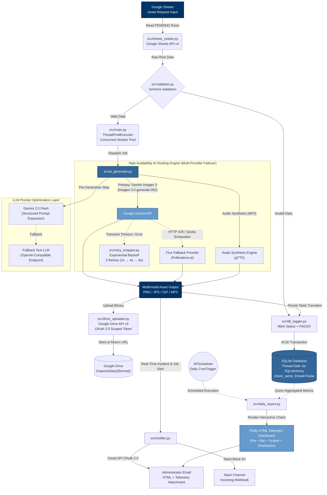
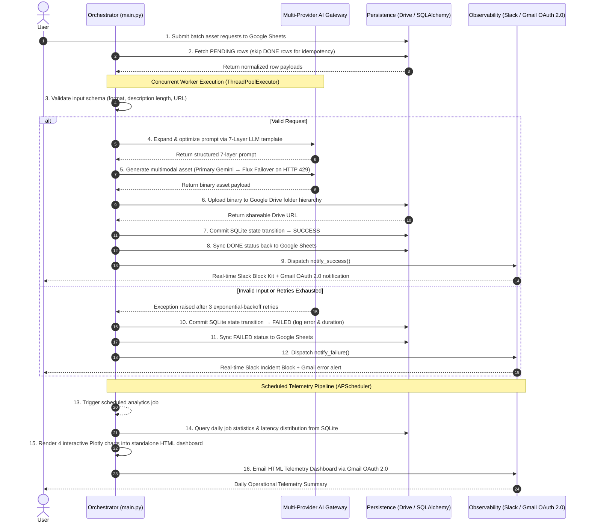

<div align="center">

# ⚡ Fault-Tolerant GenAI Asset Orchestration Pipeline

### Idempotent, Resume-Safe Multimodal Generation Pipeline with Automated Multi-Provider Failover (`HTTP 429` Handling), 7-Layer Prompt Evaluation Rubric, OAuth 2.0 Security & Scheduled Telemetry

<p align="center">
  
  
  
  
  
  
  
  
</p>

_A production-grade, fault-tolerant multimodal GenAI orchestration pipeline in Python. Built with **SQLAlchemy/SQLite idempotent job-state tracking**, **concurrent worker pools (`ThreadPoolExecutor`)**, and **exponential-backoff retries** with automated failover across LLM and diffusion providers on **`HTTP 429` rate limits**. Backed by a systematically evaluated **7-layer prompt framework** (3 iterations × 5 asset classes scored on a 5-criterion Likert rubric), **OAuth 2.0** scoped security, real-time **Slack Block Kit** incident alerting, scheduled **Plotly** telemetry dashboards, and **`pytest`** unit test suites._

**Engineered by:** [Daniel Huynh (Huynh Le Thanh Hai)](https://github.com/danielhuynh-04) • [LinkedIn](https://linkedin.com/in/le-thanh-hai-huynh-8353913a1) • [Kaggle](https://kaggle.com/lthanhhihunh)

<p align="center">
  <a href="PROMPT_ENGINEERING_REPORT_EN.md"><b>📖 Read 7-Layer Prompt Engineering Report (English)</b></a> &nbsp;•&nbsp; 
  <a href="prompt_engineering_report.md"><b>📖 Đọc Báo Cáo Kỹ Nghệ Prompt 7 Tầng (Tiếng Việt)</b></a> &nbsp;•&nbsp;
  <a href="docs/System_Design.md"><b>🏛️ System Design & Architecture</b></a>
</p>

</div>

---

## 🏆 Key Engineering Highlights

| Capability | Engineering Implementation |
|:---|:---|
| **Idempotent & Resume-Safe State Machine** | Tracks job lifecycle (`PENDING → RUNNING → SUCCESS / FAILED`) in SQLite via SQLAlchemy ORM; rows marked `DONE` are automatically skipped on rerun to prevent duplicate API consumption. |
| **High-Availability Multi-Provider Failover** | Primary **Gemini Imagen 3** (`imagen-3.0-generate-002`) automatically fails over to **Flux** (`Pollinations.ai`) upon quota exhaustion (`HTTP 429`) or transient API timeouts. |
| **Concurrent Worker Pool & Retry Backoff** | Parallel I/O execution via `ThreadPoolExecutor` paired with a custom `@retry` decorator implementing exponential backoff (`2s → 4s → 8s`, 3 attempts). |
| **7-Layer Structured Prompt Framework** | Parameterized prompt architecture (`[SUBJECT]`, `[STYLE]`, `[PALETTE]`, `[LIGHTING]`, `[COMPOSITION]`, `[TECHNICAL]`, `[NEGATIVE]`) benchmarked across **3 iterations × 5 asset classes** using a **5-criterion Likert rubric** (+123% quality improvement from V1 to V3). |
| **OAuth 2.0 Scoped Security** | Eliminates raw SMTP app passwords in favor of **Gmail API OAuth 2.0 Web Consent** and scoped **Google Drive API v3** credentials. |
| **Real-Time Incident Alerting & Telemetry** | Dispatches structured **Slack Block Kit** webhooks on job completion/failure and schedules daily **Plotly HTML telemetry dashboards** (`APScheduler` at `23:00`). |
| **Automated Unit Testing (`pytest`)** | Dedicated unit test suite covering input schema validation edge cases (`test_validator.py`) and in-memory SQLAlchemy state transitions (`test_db_logger.py`). |

---

## 🖼️ Visual Showcase: 7-Layer Prompt Framework (V3 Production Outputs)

All 5 asset categories below were generated through the pipeline and evaluated across 3 controlled iterations (`V1 → V2 → V3`) on a 25-point (5-criterion × 5-point Likert) rubric. Full methodology and prompt templates are documented in [`PROMPT_ENGINEERING_REPORT_EN.md`](PROMPT_ENGINEERING_REPORT_EN.md).

| Character Asset | Bingo Ball Asset | UI Button Asset | Card Frame Asset | Stage Background |
|:---:|:---:|:---:|:---:|:---:|
|  |  |  |  |  |
| **Game Show Host** (`1024×1024`) | **Glossy 3D Sphere** (`#7`) | **3D Bevel UI** (`PLAY`) | **Ornate Baroque Frame** | **Theatrical Stage** (`1080p`) |
| V1: `13/25` → **V3: `25/25`** | V1: `11/25` → **V3: `25/25`** | V1: `10/25` → **V3: `25/25`** | V1: `12/25` → **V3: `25/25`** | V1: `10/25` → **V3: `25/25`** |

---

## 🏗️ System Architecture



---

## 🔄 Orchestration Sequence (BPMN Flow)



---

## 🧩 Repository Structure

```text
Fault-Tolerant-GenAI-Asset-Orchestration-Pipeline/
│
├── src/                                      # Core Orchestration & Pipeline Modules
│   ├── main.py                               # ⚙️  Pipeline Orchestrator (ThreadPoolExecutor, CLI entry point)
│   ├── sheets_reader.py                      # 📊 Google Sheets API v4 Ingestion & Idempotent Row Filtering
│   ├── validator.py                          # ✅ Input Schema Validation (format, URL, description constraints)
│   ├── ai_generator.py                       # 🤖 Multi-Provider AI Gateway (Gemini Imagen 3 → Flux Failover + Audio)
│   ├── retry_wrapper.py                      # 🔄 Exponential-Backoff Retry Decorator (configurable attempts & delay)
│   ├── drive_uploader.py                     # ☁️  Google Drive API v3 Uploader (OAuth 2.0 scoped tokens)
│   ├── db_logger.py                          # 💾 SQLAlchemy ORM State Machine (thread-safe SQLite transactions)
│   ├── notifier.py                           # 📢 Slack Block Kit Webhooks + Gmail API OAuth 2.0 Notifications
│   └── daily_report.py                       # 📈 Plotly Telemetry Dashboard Generator + APScheduler CronTrigger
│
├── prompt_engineering/                       # 7-Layer Prompt Framework & Empirical Evaluation
│   ├── PROMPT_ENGINEERING_REPORT_EN.md       # Full English Prompt Engineering Report (5 assets × 3 iterations)
│   ├── prompt_engineering_report.md          # Vietnamese Prompt Engineering Report
│   └── iterations/                           # Generated V3 showcase assets (character, ball, button, frame, stage)
│
├── tests/                                    # Automated Unit Test Suite (pytest)
│   ├── conftest.py                           # Shared pytest fixtures
│   ├── test_validator.py                     # Schema validation & normalization unit tests (10 test cases)
│   └── test_db_logger.py                     # In-memory SQLAlchemy state persistence & telemetry unit tests (6 test cases)
│
├── database/                                 # Relational Schema Definition
│   └── schema.sql                            # SQLite DDL for `jobs` and `reports` tables with composite indexes
│
├── docs/                                     # System Design & Requirements Specification
│   ├── Requirement_Analysis.md               # Functional & Non-Functional Requirements (FR/NFR matrix)
│   └── System_Design.md                      # High-level architecture & BPMN swimlane design principles
│
├── tools/
│   └── populate_sheet.py                     # Utility script to seed sample benchmark requests into Google Sheets
│
├── .env.example                              # Environment configuration template (zero hardcoded secrets)
├── requirements.txt                          # Pinned Python dependencies
├── PROMPT_ENGINEERING_REPORT_EN.md           # Root shortcut to English Prompt Engineering Report
└── README.md                                 # Project documentation
```

---

## 🛠️ Technology Stack & Engineering Methods

| Layer | Technologies & Patterns |
|:---|:---|
| **Language & Data** | Python 3.10+, SQL, SQLAlchemy 2.0 ORM, SQLite (`check_same_thread=False`) |
| **Generative AI Providers** | Google Gemini Imagen 3 (`imagen-3.0-generate-002`), Gemini 2.0 Flash (`gemini-2.0-flash`), Flux Diffusion (`Pollinations.ai`), `gTTS` |
| **Cloud & Authentication** | Google Sheets API v4, Google Drive API v3, Gmail API v1, **OAuth 2.0 Web Consent (Scoped Tokens)**, Google Service Accounts |
| **Fault Tolerance & Concurrency** | `ThreadPoolExecutor` concurrent worker pool, custom `@retry` decorator with exponential backoff (`2s → 4s → 8s`), automated `HTTP 429` provider failover, idempotent `DONE`-row filtering |
| **Prompt Engineering** | 7-Layer Modular Prompt Architecture evaluated across 3 iterations and 5 asset categories using a 5-criterion Likert scale (`25/25` final score) |
| **Observability & Alerting** | Slack Incoming Webhooks (**Slack Block Kit** JSON), scheduled **Plotly** HTML telemetry dashboards (`APScheduler`) |
| **Quality Assurance** | **`pytest`** unit testing for input validation and database state machine transitions |

---

## 🚀 Quick Start

### 1. Clone & Install Dependencies
```bash
git clone https://github.com/danielhuynh-04/Fault-Tolerant-GenAI-Asset-Orchestration-Pipeline.git
cd Fault-Tolerant-GenAI-Asset-Orchestration-Pipeline
python -m venv .venv
.venv\Scripts\activate       # Windows (use `source .venv/bin/activate` on Linux/macOS)
pip install -r requirements.txt
```

### 2. Configure Google Cloud & OAuth 2.0 Credentials
> **Architecture & Requirements Reference:** [`docs/System_Design.md`](docs/System_Design.md) • [`docs/Requirement_Analysis.md`](docs/Requirement_Analysis.md)

1. Create a [Google Cloud Project](https://console.cloud.google.com) and enable **Google Sheets API**, **Google Drive API**, **Generative Language API**, and **Gmail API**.
2. Create a Service Account for Sheets access → download JSON key as `credentials.json` in the project root.
3. Obtain a [Gemini API Key](https://aistudio.google.com/app/apikey).
4. Create an [OAuth 2.0 Client ID](https://console.cloud.google.com/apis/credentials/oauthclient) (Desktop App) for Drive & Gmail API consent → save as `client_secret.json` in the project root.
5. Configure a [Slack Incoming Webhook](https://api.slack.com/messaging/webhooks) for real-time Block Kit alerts.

### 3. Environment Variables
```bash
cp .env.example .env
# Populate GEMINI_API_KEY, GOOGLE_SHEET_ID, GOOGLE_DRIVE_FOLDER_ID, SLACK_WEBHOOK_URL, and EMAIL_ADMIN
```

### 4. Run Pipeline & Unit Tests
```bash
# Run automated unit test suite (16/16 passing tests)
python -m pytest tests/ -v

# Execute the end-to-end orchestration pipeline
python src/main.py

# Generate the interactive Plotly HTML telemetry report immediately
python src/main.py --report-only

# Run pipeline with background APScheduler daily telemetry daemon
python src/main.py --with-scheduler
```

---

## 📊 Idempotent Job State Machine

```text
PENDING ──► RUNNING ──► SUCCESS (Asset generated, uploaded to Drive, persisted in SQLite, Slack/Gmail notified)
               │
               └──► RETRY (Attempt 1 → 2 → 3 with Exponential Backoff & Provider Failover on HTTP 429)
                       ├──► SUCCESS
                       └──► FAILED (Retries exhausted; error & latency persisted in SQLite, incident alert sent)

PENDING ──► FAILED (Blocked at Schema Validator prior to AI API invocation — zero wasted tokens)
```

---

<div align="center">
  <b>Daniel Huynh (Huynh Le Thanh Hai)</b><br>
  Computer Science (Database & AI Engineering) • Ho Chi Minh City Open University<br>
  <a href="mailto:Haiworkai@gmail.com">Haiworkai@gmail.com</a> • <a href="https://linkedin.com/in/le-thanh-hai-huynh-8353913a1">LinkedIn</a> • <a href="https://kaggle.com/lthanhhihunh">Kaggle</a>
</div>
